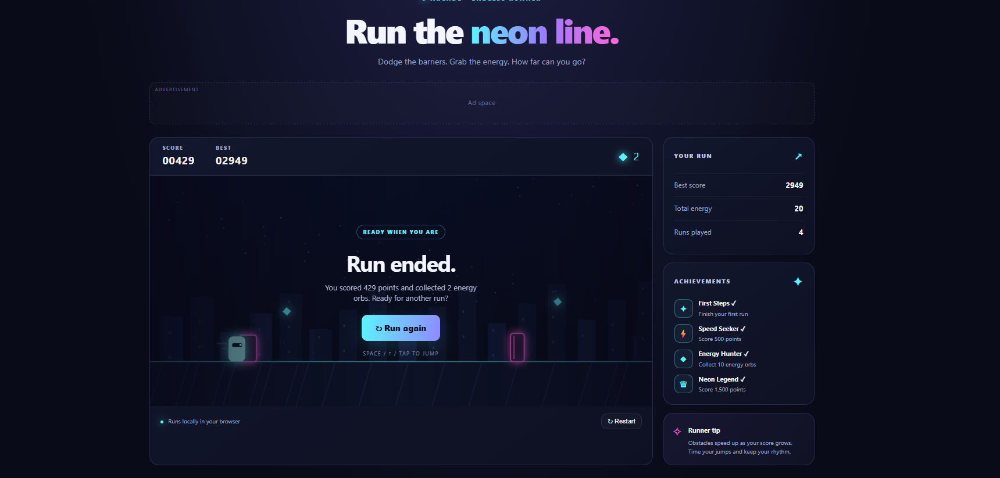

# Neon Rush — Endless Runner

A responsive HTML/CSS/JavaScript endless runner with canvas rendering, keyboard and touch controls, synthesized sound effects, local high scores, achievements, and static information pages.
g
## Run locally

No dependencies or build step are required.

1. Download or clone this repository.
2. Open `index.html` in a modern browser, or run a local static server:
   ```bash
   npx serve .
   ```
3. Open the local URL shown by the server.

## Project structure

```text
neon-rush/
├── index.html
├── style.css
├── game.js
├── privacy.html
├── about.html
├── contact.html
└── README.md
```

## Deploy to Vercel

Import the GitHub repository into Vercel. Select **Other** as the framework preset and leave the build command blank; this is a static site. The root directory is the repository root.

## Google AdSense

Ad placements are placeholders until you are approved. Before enabling ads:

1. Publish the complete site and use a domain you control where possible.
2. Replace placeholder contact details and ensure the privacy policy accurately reflects the site's real behavior.
3. Add original supporting content that is useful to visitors; a game alone may not meet Google's content-quality expectations.
4. Apply in AdSense and follow the current site-ownership verification steps.
5. Once approved, insert the official AdSense script and ad-unit code from your account. Never click your own ads or ask users to click them.
6. Review current consent requirements, privacy laws, and AdSense program policies for your audience and location.

Never commit private credentials. AdSense publisher IDs and client-side ad-unit IDs are intended for site code, but they do not bypass approval.

## Local storage

Progress is stored in the browser under `neonRushSaveV1`. Clearing browser storage resets scores and achievements. There is no online leaderboard or server-side account.
